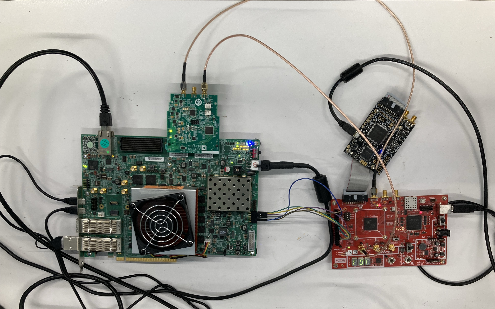
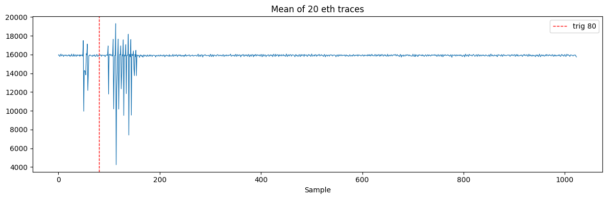

# Power Trace Collection using VCU118 and AD9467 and Transferring via Ethernet at ~500 traces/second

High-throughput **DUT power-trace probing**: a DUT bitstream runs on a NewAE **CW305**, its supply/activity is digitized by an **AD9467-FMC** on a Xilinx **VCU118**, and each capture window is streamed to a host PC over **1 GbE UDP** at on the order of **~500 traces/s**.

This repository contains the final CW305 and VCU118 RTL, constraints, Vivado projects, prebuilt bitstreams, and Jupyter notebooks used to run the capture.

## Hardware Used

| Item | Role |
|------|------|
| **Xilinx VCU118** (`xcvu9p`) | Capture FPGA: handshake, AD9467 RX, on-chip trace queue, Gigabit Ethernet UDP TX |
| **Analog Devices AD9467-FMC-250EBZ** | 16-bit ADC on VCU118 FMC HPC1; samples DUT power / sense channel |
| **NewAE CW305** (Artix-7 100T) | DUT platform (user design under test) |
| **NewAE ChipWhisperer-Lite** (optional) | USB control / programming assist for CW305 |
| **SMA coax** | CW305 CLKOUT (100 MHz) → AD9467 clock input (DCO reference path) |
| **PMOD jumpers** | Handshake between CW305 GPIO and VCU118 **J52 (PMOD0)** |
| **Ethernet** | VCU118 J10 ↔ PC USB Gigabit NIC (dedicated link recommended) |

## CW305 ↔ VCU118 Pin Connection

Connector on VCU118: **J52 (PMOD0)**. Digilent pin numbering. Do **not** connect 3.3 V on pins 11/12.

| CW305 pin | Signal | VCU118 J52 pin | FPGA package pin |
|-----------|--------|----------------|------------------|
| **A15** | `load` (VCU → DUT) | **1** | AY14 |
| **D16** | `done` (session end) | **2** | AV16 |
| **E15** | `busy` (DUT busy) | **3** | AY15 |
| **B14** | `ready` (DUT ready) | **5** | AW15 |
| **GND** | ground | **9** | GND |

Clocking (required for capture):

- CW305 PLL out1 ≈ **20 MHz** (DUT clock)
- CW305 PLL out2 ≈ **100 MHz** on CLKOUT SMA → AD9467 (DCO must be alive **before** programming the VCU bitstream)

## Repository Layout

```
fpga-power-probe/
├── README.md
├── docs/
│   ├── setup.png              # Lab setup photo
│   └── sample_trace.png       # Example captured / averaged trace
├── bitstreams/                # Prebuilt .bit / .ltx
├── notebooks/                 # Host capture + throughput notebooks
├── cw305/
│   ├── rtl/                   # DUT-side RTL
│   ├── constraints/           # cw305.xdc
│   └── vivado/cw305_dut/      # Vivado project (.xpr)
└── vcu118/
    ├── rtl/                   # Capture + Ethernet RTL
    ├── constraints/           # vcu118_capture.xdc (J52)
    ├── ip/                    # ILA + Gig Ethernet PCS/PMA (.xci)
    └── vivado/vcu118_capture/ # Vivado project (.xpr)
```

## Setup Photo



## Sample Trace

Example mean of Ethernet-delivered captures (trigger at sample 80):



## How to Use This Repository

### 1. Open / rebuild FPGA projects (Vivado 2024.2)

**CW305 DUT**

1. Open `cw305/vivado/cw305_dut/cw305_dut.xpr`
2. Confirm generics: `pLOCAL_START=0` (wait for VCU `load`), `pBUSY_TAIL_CYCLES=8`
3. Run Synthesis → Implementation → Generate Bitstream  
   (or use `bitstreams/cw305_top.bit`)

**VCU118 capture**

1. Open `vcu118/vivado/vcu118_capture/vcu118_capture.xpr`
2. Upgrade/generate IP if Vivado prompts (`ila_capture`, `gig_ethernet_pcs_pma_0`)
3. Run Synthesis → Implementation → Generate Bitstream (+ debug probes `.ltx`)  
   (or use `bitstreams/vcu118_capture_top.bit` + `.ltx`)

### 2. Wire the hardware

1. Mount AD9467-FMC on VCU118 HPC1  
2. Connect CW305 ↔ VCU118 **J52** per the table above  
3. SMA: CW305 CLKOUT → AD9467 clock input  
4. Ethernet: VCU118 J10 → PC USB Ethernet adapter (keep the PC’s internet NIC separate)

### 3. Program boards (recommended order)

1. USB-reset CW305, then force-program `cw305_top.bit` (ChipWhisperer / notebook)  
2. Enable CW305 PLLs (20 MHz + 100 MHz) and wait several seconds for AD9467 DCO  
3. In Vivado Hardware Manager, program `vcu118_capture_top.bit` (+ `.ltx`)  
4. Confirm VCU **LED5** (Ethernet link) is on  

USB-reset of CW305 cuts the PLL — if you reprogram CW305, re-enable clocks and **reprogram the VCU** afterward.

### 4. Run host capture

Use the ChipWhisperer Python environment and open:

- `notebooks/dut_power_trace_eth.ipynb` — program CW305, receive UDP traces, plot  
- `notebooks/dut_throughput_10k.ipynb` — measure sustained capture throughput (~10k traces)

Bind the UDP socket to the **USB Ethernet** interface that faces the VCU118 (often a `169.254.x.x` or a static `192.168.1.x` address), not the internet NIC.

### 5. What “good” looks like

- Host `REG_CRYPT_GO` / busy clears each run (`busy=0x00`)  
- UDP traces arrive with magic `0xAE511ACE`, 1024 samples, trigger position 80  
- Sustained rates on the order of **~500 traces/s** when the Ethernet drain keeps up with the 16-deep on-chip queue  

## License / Notes

Hardware interfaces and third-party IP (Xilinx Gigabit Ethernet PCS/PMA, ILA) remain under their respective vendor licenses. RTL in this repo is provided for research and lab reproduction of the DUT power-probe capture path.
